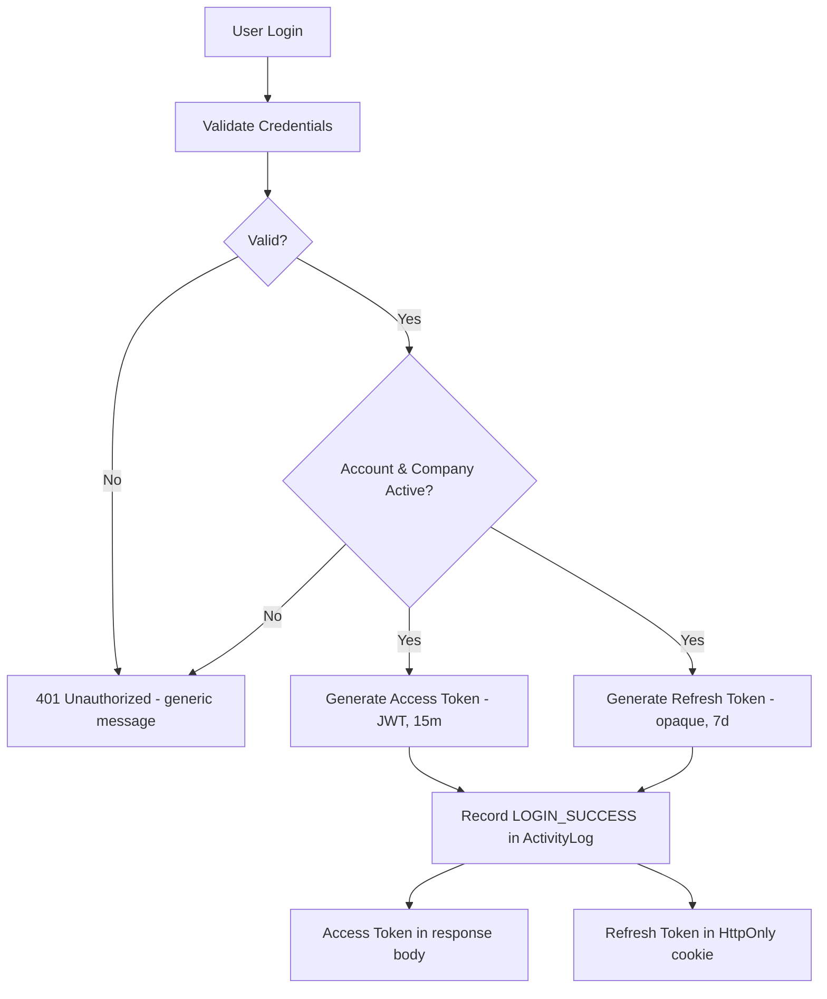

# Authentication & Authorization

## 1. Overview

Access-token (JWT) + refresh-token (opaque, rotating) authentication, with
role-based and company-based (multi-tenant) authorization enforced entirely
server-side. The frontend's route protection is UX only.

## 2. Authentication flow



Login validation order (matches `auth.service.js::login`): find user by
email → verify password hash → check `user.status === ACTIVE` → check the
user's company isn't `SUSPENDED` (skipped for `SUPER_ADMIN`, who has no
company) → issue tokens → record activity → respond.

## 3. JWT strategy (access token)

- Signed with `JWT_ACCESS_SECRET`, 15-minute lifetime (`JWT_ACCESS_EXPIRES_IN`).
- Payload: `{ sub: userId, role: roleName, companyId }` — nothing else.
  No email, no name, no password hash. JWTs are base64-encoded, not
  encrypted; anything in the payload is effectively public.
- **Every** request still re-reads the user and company from the database
  (`authenticate.js`) rather than trusting the JWT payload for role/status —
  a role change or suspension takes effect on the very next request, not
  after the access token happens to expire.
- Tenant access JWTs carry the company's dedicated `securityVersion` at
  issuance. Authentication requires that value to match the current company
  row, making all tenant JWTs from before a company status transition invalid
  permanently, including after reactivation. Unrelated company profile edits
  do not change this version. A new login after reactivation receives the
  current version. Super Admin JWTs are not company-scoped.

## 4. Refresh token strategy

Refresh tokens are **not** JWTs — they're 256-bit random values
(`crypto.randomBytes(32)`), returned to the client once, and stored in
`refresh_tokens.tokenHash` as an HMAC-SHA256 hash (keyed with
`JWT_REFRESH_SECRET`), never in plain text. See `src/utils/token.js` for why
HMAC rather than Argon2 is used here (fast, deterministic lookup by hash —
appropriate for a high-entropy random token, unlike a human-chosen password).

**Rotation**: every `POST /api/auth/refresh` call issues a brand-new refresh
token and revokes the one that was just used, linking them via
`replacedByTokenId`, inside one Prisma transaction (`$transaction`). The
revocation uses a conditional update so simultaneous requests cannot both
successfully rotate the same token.

**Reuse detection**: if a *revoked* refresh token is presented again — the
strongest signal available that a token was stolen and the legitimate user
already rotated past it — every active session for that user is revoked
immediately, not just the one token. This is intentional over-response:
the cost of forcing a re-login is far lower than the cost of an attacker
keeping a live session.

## 5. Cookie strategy

The refresh token lives **only** in an HttpOnly cookie scoped to
`/api/auth` (not the whole API — it's only ever sent to the handful of
endpoints that need it: `/refresh`, `/logout`). It is never placed in
`localStorage`. Cookie flags:

| Flag | Value | Why |
|---|---|---|
| `HttpOnly` | always | JavaScript cannot read it — mitigates XSS token theft |
| `Secure` | `COOKIE_SECURE` env (true in prod) | Only sent over HTTPS in production |
| `SameSite` | `COOKIE_SAME_SITE` env (`lax` in dev) | CSRF mitigation — see §9 |
| `path` | `/api/auth` | Minimizes exposure surface |

The **access token** lives only in a frontend JS module-level variable
(`frontend/src/lib/tokenStore.js`) — never `localStorage`, never a cookie.
It's lost on page reload by design; `AuthContext` re-establishes it on app
start via `GET /api/auth/me`, which succeeds because the HttpOnly refresh
cookie is still present and the Axios response interceptor transparently
refreshes on the resulting 401.

## 6. Role hierarchy & permission matrix

```text
SUPER_ADMIN    → platform-wide, no companyId, bypasses companyAccess checks
COMPANY_ADMIN  → full control within own company only
INSTRUCTOR     → assigned courses/lessons/quizzes/grading within own company
EMPLOYEE       → own profile, own assigned learning, own submissions/certs
```

| Action | SUPER_ADMIN | COMPANY_ADMIN | INSTRUCTOR | EMPLOYEE |
|---|---|---|---|---|
| Manage companies | ✅ | ❌ | ❌ | ❌ |
| Manage own company's employees | ➖ (platform scope) | ✅ | ❌ | ❌ |
| View own company data | ➖ | ✅ | ✅ (assigned) | ✅ (own) |
| View another company's data | ✅ (explicit platform action) | ❌ | ❌ | ❌ |
| View another employee's private data | ✅ | ✅ (own company) | ❌ | ❌ |

Enforced by `authorize(...roles)` (role check) stacked with
`companyAccess()`/`assertSameCompany()` (tenant check) — see `employee.routes.js`
for the concrete example (`GET /api/employees/:id`).

## 7. Multi-tenant security

**The only source of `companyId` for any authorization decision is
`req.user.companyId`**, populated by `authenticate.js` from a fresh
database read of the authenticated user — never from `req.body`,
`req.query`, or `req.params`. A malicious `{ "companyId": "..." }` in a
request payload is simply never read for this purpose.

For single-resource endpoints (`GET /api/employees/:id`), `companyAccess()`
loads the resource's *actual* owning company and compares it to
`req.user.companyId`, returning **404** (not 403) on a mismatch — see
`middleware/companyAccess.js` for why 404 was chosen: confirming a resource
exists in a tenant you can't see is itself a cross-tenant information leak.

## 8. Password policy

Minimum 8 characters, at least one uppercase letter, one lowercase letter,
one number (`src/utils/password.js::checkPasswordPolicy`, mirrored in the
Zod schema so the same rule can't drift between the two layers). Hashed
with **Argon2id** (`src/utils/password.js`) — the variant recommended for
password storage specifically, as opposed to Argon2i/Argon2d.

## 9. CORS & CSRF

CORS origin is a single explicit value (`CLIENT_URL`/`FRONTEND_URL`) with
`credentials: true` — never `origin: "*"`, which CORS forbids combining
with credentials anyway. In production, `SameSite=None; Secure` would be
needed only if the frontend and API are on different origins; same-site
deployment can stay `Lax`. Because the refresh cookie is `SameSite=Lax` (or
stricter) and scoped to `/api/auth`, and the access token must be
explicitly attached via a JS-readable `Authorization` header (which a
cross-site form POST cannot forge), a dedicated CSRF token was judged
unnecessary for this deployment shape — revisit if `SameSite=None` becomes
required (cross-origin frontend/API).

## 10. Error handling & HTTP status codes

Every response follows `{ success, message, data|error }`. Status codes
used: `200`, `201`, `400`, `401`, `403`, `404`, `409` (duplicate email),
`422` (validation), `429` (rate limit), `500`.

Authentication errors are deliberately generic:
- Login: **"Invalid email or password"** for both a wrong password *and* an
  unknown email — never reveals which.
- Forgot password / resend verification: **"If the account exists..."** —
  same response whether or not the email is registered.

## 11. Auth activity log

Reuses the existing `ActivityLog` table (no new table needed)
with `entity = 'AUTH'` and actions: `LOGIN_SUCCESS`, `LOGIN_FAILED`,
`LOGOUT`, `PASSWORD_RESET_REQUESTED`, `PASSWORD_RESET_COMPLETED`,
`EMAIL_VERIFIED`, `REFRESH_TOKEN_REVOKED`, `REGISTER_COMPANY`. Never logs a
password or raw token — only metadata like `{ reason: 'invalid_password' }`.

## 12. Rate limiting

| Endpoint(s) | Window | Max |
|---|---|---|
| `/login` | 15 min | 10 |
| `/register-company` | 60 min | 5 |
| `/forgot-password`, `/reset-password` | 15 min | 5 |
| `/refresh` | 15 min | 60 (called automatically by the frontend) |
| `/verify-email`, `/resend-verification` | 15 min | 10 |

## 13. Security decisions summary

- Argon2id for passwords; HMAC-SHA256 for opaque token hashing (different
  tools for different threat models — see §4).
- `authenticate` re-reads the DB every request; JWT claims are never
  trusted for authorization, only identity.
- Refresh token rotation + reuse detection with full-session revocation.
- Credential and access-critical administrative changes invalidate unused
  password-reset links and revoke all active refresh sessions atomically.
  Reset consumption locks the user row and consumes the token conditionally,
  serializing it with Super Admin credential updates.
- A company status transition (including reactivation) revokes all tenant
  refresh sessions and increments the company's dedicated `securityVersion`
  access-token epoch. The update, revocation, and audit record are one
  transaction. The additive `securityVersion` migration must be applied before
  deploying this version; deployment details are in the migration README.
- Password reset revokes **all** active sessions, not just the one that
  requested it.
- 404 (not 403) on cross-tenant resource access — no existence leak.
- Generic error messages on login/forgot-password — no account enumeration.
- `companyId`/`role`/`userId` are never trusted from client input, anywhere.
- Company registration is atomic (Prisma `$transaction`) — verified by
  intentionally forcing a mid-transaction failure and confirming rollback
  (see §15).

## 14. Environment variables

```env
JWT_ACCESS_SECRET=          # signs the access token (real JWT)
JWT_REFRESH_SECRET=         # HMACs opaque refresh/reset/verification tokens
JWT_ACCESS_EXPIRES_IN=15m
JWT_REFRESH_EXPIRES_IN=7d

COOKIE_SECURE=false         # true in production (HTTPS only)
COOKIE_SAME_SITE=lax
```

`CLIENT_URL` doubles as the `FRONTEND_URL` used by the application — used for both CORS and building reset/verify links.

## 15. Testing performed

Prisma's CLI (`generate`/`migrate`/`studio`) can't reach
`binaries.prisma.sh` from this sandbox (see the note in the main README) — correctness was verified through three
independent, real channels rather than skipped:

**A. Pure unit tests (no DB) — 12/12 passed**
Argon2id hash/verify round-trip, password-policy edge cases, JWT
sign/verify round-trip, tampered/garbage-token rejection, opaque token
uniqueness, and hash determinism — using the *actual* `src/utils/*.js`
files, not reimplementations.

**B. Live HTTP tests against a booted Express server — 11/11 passed**
Ran the real `app.js`/routes/middleware stack end-to-end (with a throwaway
mock swapped in only for the generated Prisma Client, since its engine
binary is what's blocked — every route, middleware, and validator is the
real shipped code): validation (422 on bad login/register payloads),
generic 401 on unknown credentials, 401 on missing/malformed auth headers,
401 on a stale/deleted user re-check, security headers present (Helmet:
CSP, X-Frame-Options, X-Content-Type-Options, Referrer-Policy), CORS
`Access-Control-Allow-Credentials: true` with an explicit origin, and rate
limiting triggering exactly at request #11 against a 10-request limit.

**C. Full flow tests against the live PostgreSQL database — 24/24 passed**
Using the real `password.js`/`jwt.js`/`token.js` utilities directly against
real rows: company-registration transaction commit, forced-failure
rollback (no orphan company), correct/wrong-password verification, unknown
email, inactive account, suspended company, refresh token issuance,
rotation (old token revoked + linked to replacement), reuse detection
(all sessions revoked), expiry detection, `tokenHash` unique constraint,
full password-reset flow (password changed, old password rejected, token
marked used, all sessions revoked), expired reset token, cross-tenant
employee lookup blocked, same-tenant lookup allowed, cascade delete of a
user's refresh tokens, and JWT payload correctness including
`SUPER_ADMIN`'s null `companyId`.

**D. Frontend build — passed**
`npm run build` completes with 0 errors (146 modules); the Vite dev server
boots and serves the app.

All test/verification scripts and their data were deleted from the
database and the repo before packaging — nothing sandbox-only ships.

## 16. What's deferred (by design, per spec §1/§54)

- Production email delivery (mock console logger is in place; see
  `mail.service.js` — swapping in a real provider touches only that file).
- Employee invitation-by-email flow (temporary-password creation is live;
  the architecture — one-time hashed tokens — already exists via
  `EmailVerificationToken` and is ready to reuse for invitations).
- Dedicated CSRF token (see §9 for why it isn't needed yet).
- Persistent account lockout (rate limiting is the current defense; a lockout mechanism remains a future security enhancement per the spec's own caution
  against making it attacker-abusable).
