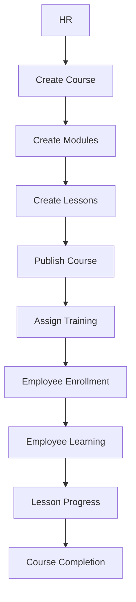

# Phase 4 — LMS Core & Learning Management

## 1. Inspection performed before coding

Confirmed from Phase 1–3, and reused rather than duplicated:
- `Course`, `Module`, `Lesson`, `Enrollment`, `LessonProgress`, `Notification`
  (with `TRAINING_ASSIGNED` already in its enum), `ActivityLog` all already
  existed in `schema.prisma` from Phase 2 — **zero new models created**.
- `authenticate` / `authorize` / `companyAccess` middleware, the Prisma
  client singleton (`config/db.js`), the Zod `validate` middleware, the
  standard `{success, message, data}` response shape, and the
  `AppError`/`asyncHandler` error-handling pattern — all reused as-is.
- Frontend: `AuthContext`, `useAuth`, `ProtectedRoute`, `apiClient` (with its
  token-refresh interceptor), and the warm cream/gold/burgundy design
  tokens introduced in Phase 3 for the auth pages. Phase 4 extends that
  same palette to the full HR/Employee UI, per this phase's explicit
  design-system instruction — so what looked like an open question in
  Phase 3 ("is this auth-only or the whole app?") is now resolved: it's the
  whole app.

**The only schema change needed**: `Enrollment.dueDate` didn't exist yet
(Phase 2's spec didn't ask for it). Added via a proper migration
(`20260826103924_add_enrollment_due_date`), hand-verified against the live
database exactly as Phase 2 and 3 were.

## 2. Architecture

### Course / Module / Lesson
Standard tree: `Course → Module[] → Lesson[]`, each `@@unique`-ordered
within its parent. A course starts `DRAFT`, can only become `PUBLISHED`
once it passes the readiness checklist (§4), and moves to `ARCHIVED`
without ever being hard-deleted (existing enrollment/progress history is
untouched — this was already the delete-behavior design from Phase 2).

### Enrollment / Progress
`progress.service.js` is the single source of truth for course-progress
math (`completedLessons / totalLessons × 100`), reused identically by:
lesson completion, course-detail's learner list, HR training monitoring,
and the HR dashboard's average-progress stat. There is exactly one place
this formula lives.



## 3. Multi-tenant & role security

Every course/module/lesson mutation resolves its tenant from
`req.user.companyId` (never `req.body.companyId`) and, for the
`INSTRUCTOR` role specifically, additionally checks `course.instructorId
=== req.user.id` — an instructor at the same company who isn't assigned to
a course gets the identical 404 a different company would get. This is
enforced once, centrally, in `loadCourseForWrite`/`loadModuleForWrite`
(module.service.js) and `loadLessonForWrite`(lesson.service.js) — every
course/module/lesson write path goes through one of these three functions,
so the check can't be forgotten on a new endpoint.

Employees never go through those functions at all — `/api/me/*` and lesson
completion check **enrollment ownership**, not company-admin/instructor
scoping, which is a deliberately different (and narrower) trust boundary:
an employee's own enrollment, not "any resource in my company."

## 4. Publish validation

`getPublishReadiness` (course.service.js) checks, in order: title present,
description present, instructor assigned, at least one module, at least
one lesson total, and every module has at least one lesson. All failing
checks are collected and returned together (`{ ready: false, problems:
[...] }`) rather than stopping at the first one, so the HR user sees the
complete list — "Course cannot be published yet" followed by every missing
requirement, in one pass.

## 5. Training assignment — trust boundaries, in the order enforced

1. `course.companyId === actingUser.companyId` (never trust a client-sent
   `courseId` beyond "does this belong to me")
2. `course.status === 'PUBLISHED'`
3. Every `employeeId` resolves to a real user; every one's
   `companyId === actingUser.companyId` — if even **one** doesn't, the
   entire request is rejected before anything is written (verified live —
   see §9)
4. Every one's `status === 'ACTIVE'`
5. Existing enrollments are **skipped**, not re-created, and reported
   separately: `{ assigned: N, alreadyAssigned: M }`

Steps 1–4 all run as read-only checks before the write transaction opens.
Enrollment + notification + activity-log creation happens inside one
`prisma.$transaction`.

## 6. Storage & HTML sanitization

`storage.service.js` is a thin abstraction (`uploadBuffer`) — local disk
today (files land in `backend/uploads/`, served at `/uploads/<file>`),
switchable to S3/Supabase/R2 later by implementing that one function for a
new `STORAGE_DRIVER` value; no call site changes. TEXT lesson content is
sanitized server-side (`sanitizeHtml.js`, allowlist-based) before it's ever
written to the database — the frontend's rich-text input is never trusted.

## 7. API endpoints

```
GET    /api/courses                         (COMPANY_ADMIN, INSTRUCTOR — instructor sees only assigned courses)
POST   /api/courses                         (COMPANY_ADMIN)
GET    /api/courses/:id
PATCH  /api/courses/:id
GET    /api/courses/:id/publish-readiness
POST   /api/courses/:id/publish             (COMPANY_ADMIN)
POST   /api/courses/:id/archive             (COMPANY_ADMIN)

POST   /api/courses/:courseId/modules
POST   /api/courses/:courseId/modules/reorder
PATCH  /api/modules/:id
DELETE /api/modules/:id

POST   /api/modules/:moduleId/lessons
POST   /api/modules/:moduleId/lessons/reorder
GET    /api/lessons/:id                     (any authenticated role — branches by role internally)
PATCH  /api/lessons/:id
DELETE /api/lessons/:id
POST   /api/lessons/:id/complete            (learner's own enrollment, any role)

GET    /api/trainings                       (COMPANY_ADMIN)
GET    /api/trainings/:id                   (COMPANY_ADMIN)
POST   /api/trainings/assign                (COMPANY_ADMIN)

GET    /api/me/courses
GET    /api/me/courses/:id
GET    /api/me/learning-summary

GET    /api/dashboard/hr                    (COMPANY_ADMIN)
POST   /api/uploads                         (COMPANY_ADMIN, INSTRUCTOR)
```

All list endpoints (`/courses`, `/trainings`, `/me/courses`) accept
`page`, `limit`, `search`, `sort`, `order` and respond with
`{ data, pagination: { page, limit, total, totalPages } }` —
`utils/pagination.js` is the one place this shape is built.

## 8. Permission matrix (Phase 4 additions)

| Action | SUPER_ADMIN | COMPANY_ADMIN | INSTRUCTOR | EMPLOYEE |
|---|---|---|---|---|
| Create/publish/archive course | — | Yes | No | No |
| Edit course/modules/lessons | — | Yes (own company) | Yes (own assigned courses only) | No |
| List courses | — | Yes | Yes (assigned only) | No (uses `/me/courses` instead) |
| Assign training | — | Yes | No | No |
| View training monitoring | — | Yes | No | No |
| View/complete own lessons | — | — | — | Yes (enrollment-gated) |
| View HR dashboard | — | Yes | No | No |

## 9. Testing performed

Prisma's CLI still can't reach `binaries.prisma.sh` from this sandbox (see
Phase 2/3's notes) — correctness was verified the same three-layer way:

**A. 11 live HTTP tests** against a booted `app.js`/routes/middleware stack
(real code, mocked only at the generated-Prisma-Client layer): role
authorization (Employee blocked from `/api/courses`, Instructor blocked
from creating one), validation (missing fields to 422, invalid LINK URL to
422), 404 on a nonexistent course, and confirmed an Instructor *can* list
courses while an Employee is correctly routed away from that surface
entirely.

**B. 29 tests against the live PostgreSQL database**, using real inserts
through the actual schema: `(companyId, slug)` uniqueness (and that the
*same* slug is fine across two different companies), publish-readiness
gating at each stage (0 modules, then 0 lessons, then has content), the
two-pass reorder technique proven not to trip the `(courseId, order)`
unique constraint mid-update, the **full training-assignment transaction**
including a cross-tenant employee being detected before anything commits
and an inactive employee being rejected, duplicate-enrollment detection
backed by a real unique-constraint test, progress recalculation at 50%
(status becomes `IN_PROGRESS`) and 100% (status becomes `COMPLETED`,
`completedAt` set), an employee with zero progress correctly staying at
`ASSIGNED`, cross-tenant course isolation, instructor-scoped visibility
(assigned vs. unassigned instructor, same company), cascade-delete of an
empty module's lessons, and — critically — a lesson **with** learner
progress being **blocked** from deletion (the `Lesson -> LessonProgress`
`Restrict` rule from Phase 2, now exercised by a real write path for the
first time).

**C. Frontend build** — `npm run build` succeeds with 0 errors (174
modules); the Vite dev server boots and serves the app.

All verification data and scripts were deleted before packaging.

## 10. Known limitations

- **No browser-level UI testing.** This environment has no browser
  automation tool, so the frontend was verified by a clean production
  build (catches every import/syntax/type-shape error across all new
  files) and careful code review — not by clicking through it. Please spot
  check the actual flows (create, build, publish, assign, learn, complete)
  once you have it running locally.
- **No dedicated Instructor UI.** The Phase 4 spec's explicit page list
  only defines HR and Employee screens; Instructor permissions are fully
  enforced at the API level (an Instructor really can list/edit only their
  assigned courses), but there's no `/instructor/*` page consuming that
  yet — it still shows the Phase 3 placeholder dashboard.
- **Reorder is "set the whole new order," not drag-and-drop.** The API
  (`POST .../reorder` with a full ordered-id array) supports drag-and-drop
  UI, but no such UI was built — Edit/Delete on modules and lessons exist;
  visual reordering is a natural follow-up.
- Everything already listed as deferred from Phase 1–3 (real email
  delivery, S3-class storage, CSRF token, account lockout) remains
  deferred, unchanged.

## 11. Environment variables

No new environment variables — `STORAGE_DRIVER=local` and
`LOCAL_UPLOAD_DIR=uploads` (both already in `.env.example` since Phase 1)
now do real work: uploaded lesson files land there and are served at
`/uploads/<file>`.
