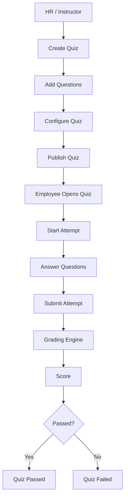

# Phase 5 — Quiz & Assessment Engine

## 1. Inspection performed before coding

Quiz-related models already existed from Phase 2 — more completely than a
typical greenfield start:
- `Quiz` (courseId, title, description, passingScore, timeLimit,
  attemptLimit, status)
- `Question` (quizId, question, type, points, order) — type enum was
  `MULTIPLE_CHOICE | MULTIPLE_ANSWER | TRUE_FALSE | ESSAY`
- `QuestionOption` — `isCorrect` was **already documented** as "never sent
  to frontend pre-attempt," anticipating this phase's Module 40 requirement
- `QuizAttempt`, `QuizAnswer`, `QuizAnswerOption` — the attempt/answer
  junction structure already supported multi-select answers

**Naming decision, not a duplication**: Phase 2's `MULTIPLE_CHOICE` means
*single-select* (this spec's `SINGLE_CHOICE`); Phase 2's `MULTIPLE_ANSWER`
means *multi-select* (this spec's `MULTIPLE_CHOICE`). Renaming the enum
would be a destructive migration for zero functional gain, so the existing
values were kept and this mapping is documented here rather than silently
assumed. `SHORT_ANSWER` was added as a new enum value; `ESSAY` stays in the
schema, reserved for future manual grading, and is **not exposed** in the
Phase 5 question-type picker (per spec: "do not implement a complicated
manual grading interface unless required for current short-answer
behavior" — short answer here is auto-graded, essay is not).

**Every schema change this phase is additive** — no column or enum value
was ever dropped or renamed:
- `Question`: `+explanation`, `+acceptedAnswers`
- `Quiz`: `+lessonId`, `+instructions`, `+shuffleQuestions`,
  `+shuffleOptions`, `+showCorrectAnswers`, `+createdById`
- `QuizAttemptStatus` enum: `+SUBMITTED`, `+GRADED`, `+EXPIRED` (`PASSED`/
  `FAILED` remain in the Postgres enum type — you cannot drop enum values
  in place — but the application no longer writes them; pass/fail now
  lives in the new `QuizAttempt.passed` boolean, decoupled from the
  process-state enum)
- `QuizAttempt`: `+passed`, `+submittedAt`, `+questionOrder`, `+optionOrder`

Reused as-is: the full Course → Module → Lesson → Enrollment chain,
`authenticate`/`authorize`/`companyAccess`, the Prisma singleton,
`ActivityLog`, and `Notification.type` — which already had `QUIZ_RESULT`,
so no new notification type was needed either.

## 2. Architecture

```
Course → Module → Lesson → Quiz → Question → QuestionOption
Employee → QuizAttempt → QuizAnswer → QuizAnswerOption
```

Quiz attaches to a **Course** (required, the tenant/company anchor) and
optionally a specific **Lesson** (`Quiz.lessonId`, nullable) — course-level
and lesson-level quizzes are both supported without a redundant `moduleId`
column (a lesson's module is reachable via `lesson.module`).



## 3. Question types & grading engine

`quizGrading.service.js` is a **pure module** — no DB, no Express, no
React — exactly as spec Module 19 demands ("do not put grading logic
inside React, Controller, or route handler"). It exports `gradeQuestion`,
`gradeAttempt`, `determinePassFail`; `quizAttempt.service.js` is the only
caller.

| Type (this schema) | Type (spec name) | Grading rule |
|---|---|---|
| `MULTIPLE_CHOICE` | Single Choice | Exactly one option selected, must match the one correct option |
| `MULTIPLE_ANSWER` | Multiple Choice | All-or-nothing set equality — any missing/extra selection scores 0 |
| `TRUE_FALSE` | True/False | Same mechanism as `MULTIPLE_CHOICE`, using the question's two options |
| `SHORT_ANSWER` | Short Answer | Normalized text match against `Question.acceptedAnswers` |
| `ESSAY` (reserved) | — | Not auto-graded (`isCorrect`/`pointsEarned` are `null`); not selectable in the Phase 5 builder UI |

Normalization (`utils/normalizeAnswer.js`): trim, lowercase, hyphens to
spaces, collapse whitespace. `"Multi-Factor   Authentication"` and
`"multi factor authentication"` are equivalent; the question stores a list
of accepted normalized variants, checked with `.some()`.

Score = `earnedPoints / totalPoints x 100`, rounded. Unanswered questions
still count in `totalPoints` (score 0 for that question) — spec Module 30's
default.

## 4. Attempt lifecycle & timer

Statuses: `IN_PROGRESS -> GRADED` (normal path) or `IN_PROGRESS -> EXPIRED`
(deadline passed before/at submission). **Simplification, documented
rather than hidden**: `SUBMITTED` exists in the schema per spec Module 15
but is never a *persisted resting state* in this implementation — grading
runs synchronously inside the same transaction as submission, so there is
no observable gap between "submitted" and "graded" to store a row in. Both
`GRADED` and `EXPIRED` are terminal states with `score`/`passed` populated;
`submittedAt` records when either was reached.

**The timer is backend-enforced, never trusted from the client** (spec
Module 14's core rule). `computeDeadline` is `attempt.startedAt +
quiz.timeLimit` — never stored, always computed, so it can't drift from
the source values. `ensureNotExpired` is called at the top of every read
(`getAttemptForTaking`) and write (`saveAnswer`, `submitAttempt`) on an
`IN_PROGRESS` attempt; if the deadline has passed, it runs the **exact same
grading transaction** a normal submit would (`gradeAndFinalize`), just
tagged `expired: true`. There is exactly one grading code path — a
timed-out attempt and a manually-submitted attempt are graded identically,
they just end up in different terminal statuses.

**Resume, not duplicate**: starting a quiz with an existing `IN_PROGRESS`
attempt returns that attempt (after checking it hasn't expired) rather than
creating a second one — this is what makes page refresh, closing the
browser, and two open tabs (spec edge cases #4, #5, #17) all safe without
any special-casing in the frontend.

**Double-submission** (edge case #9, spec Module 58): `submitAttempt`
checks `FINALIZED_STATUSES.includes(attempt.status)` first — if already
`GRADED`/`EXPIRED`, it returns that existing result instead of grading
again. Only one grading pass ever executes per attempt.

## 5. Randomization & snapshot integrity

`utils/quizSnapshot.js`: Fisher-Yates shuffle, run **once**, at attempt
start. The resulting order (`questionOrder`, and per-question
`optionOrder`) is stored as JSON on `QuizAttempt` — this is spec Module
42's "QuizAttemptSnapshot," implemented as JSON columns rather than a
separate model, since that's all the ordering data actually requires.
Every subsequent read re-applies the stored snapshot
(`applySnapshotOrder`) instead of re-shuffling, so refreshing the page
never reshuffles a question out from under a half-finished answer, and a
quiz HR edits mid-attempt (adds/removes/reorders questions) can never
retroactively change what an in-progress or historical attempt looked
like — a since-removed question is dropped from the replay, a newly-added
one is appended at the end rather than silently hidden.

## 6. Security model

- **`isCorrect` and `acceptedAnswers` never reach the employee-facing
  shape**, at any point before grading. `toEmployeeQuestion()` in
  `quizAttempt.service.js` is the one function that shapes questions for
  the learner, and it only ever copies `{ id, optionText }` — verified
  directly against real data in testing (see section 9).
- **Attempt ownership is the entire access control** for
  `/api/quiz-attempts/*` — no company/role check, just `attempt.userId ===
  req.user.id`. This is deliberate: an HR admin has no legitimate reason to
  load a specific attempt through the *employee* endpoint; staff use the
  separate `/staff-detail` endpoint, which checks company/instructor
  scoping instead.
- **Quiz access requires enrollment**, not just company membership —
  checked in `assertEnrolledAndCourseAccess`, mirroring Lesson access from
  Phase 4.
- **`showCorrectAnswers` gates only the learner's view.** HR/Instructor
  reviewing an attempt via `getAttemptDetailForStaff` always see the full
  correct-answer breakdown regardless of that flag — they're authorized to
  see it either way; the flag controls what a *learner* is told.
- **Multi-tenant + instructor scoping** for quiz/question management reuses
  the exact pattern from Phase 4's `loadCourseForWrite`:
  `loadQuizForWrite` checks `course.companyId` and, for `INSTRUCTOR`,
  `course.instructorId === req.user.id` — one function, every quiz/question
  write path goes through it.

## 7. API endpoints

```
GET    /api/quizzes                              (COMPANY_ADMIN, INSTRUCTOR)
POST   /api/quizzes                               (COMPANY_ADMIN, INSTRUCTOR - instructor limited to own courses)
GET    /api/quizzes/:id
PATCH  /api/quizzes/:id
GET    /api/quizzes/:id/publish-readiness
POST   /api/quizzes/:id/publish
POST   /api/quizzes/:id/archive
GET    /api/quizzes/:quizId/results               (HR/Instructor monitoring)

POST   /api/quizzes/:quizId/questions
POST   /api/quizzes/:quizId/questions/reorder
PATCH  /api/questions/:id
DELETE /api/questions/:id

POST   /api/quizzes/:quizId/attempts               (employee - start or resume)
GET    /api/quiz-attempts/:attemptId                (employee - ownership-gated)
PUT    /api/quiz-attempts/:attemptId/answers/:questionId
POST   /api/quiz-attempts/:attemptId/submit
GET    /api/quiz-attempts/:attemptId/result         (employee's own, gated by showCorrectAnswers)
GET    /api/quiz-attempts/:attemptId/staff-detail    (HR/Instructor, always full detail)

GET    /api/me/quizzes
GET    /api/me/quiz-history
```

**Documented deviation from the spec's literal endpoint list**: the spec
lists one `GET /api/quiz-attempts/:attemptId/result` under both the
employee ATTEMPTS section and the HR RESULTS section. Rather than branch a
single handler on `req.user.role` (which would blur two genuinely
different authorization models — ownership vs. company/instructor
scoping — into one function), this implementation keeps them as two
routes: the employee's own gated result at `.../result`, and staff's
always-full detail at `.../staff-detail`. Same underlying data, two
independently-reasoned-about access paths.

## 8. Permission matrix (Phase 5 additions)

| Action | COMPANY_ADMIN | INSTRUCTOR | EMPLOYEE |
|---|---|---|---|
| Create/edit/publish/archive quiz | Yes | Yes (own courses only) | No |
| Create/edit/delete question | Yes | Yes (own courses only) | No |
| List quizzes (management view) | Yes | Yes (assigned only) | No (`/me/quizzes` instead) |
| Start/answer/submit attempt | No | No | Yes (own attempts, enrollment-gated) |
| View own result | No | No | Yes |
| View all quiz results | Yes | Yes (own courses only) | No |
| View attempt detail | Yes | Yes (own courses only) | No |

## 9. Testing performed

Same three-layer approach as Phases 2-4 (Prisma CLI still can't reach
`binaries.prisma.sh` from this sandbox):

**A. 23 grading-engine unit tests** (pure, no DB) — every question type's
correct/incorrect/unanswered/partial cases, `MULTIPLE_ANSWER`'s
all-or-nothing rule specifically (exact match, partial match scores 0,
extra-wrong-option scores 0, order doesn't matter), `SHORT_ANSWER`
normalization (case, hyphens, whitespace, multiple accepted variants),
`ESSAY` correctly returning `null` rather than 0, a full multi-question
`gradeAttempt` pass, and pass/fail boundary conditions.

**B. 7 snapshot/randomization unit tests** — shuffle produces a complete,
duplicate-free ordering; re-applying a stored snapshot twice gives
identical results; a question removed from the quiz after the snapshot was
taken is dropped without crashing; a question added afterward is appended
rather than silently hidden.

**C. 11 live HTTP tests** against a booted server (real routes/middleware,
Prisma Client mocked only at the generated-client layer): Employee blocked
from quiz management (403), Instructor allowed to create (reaches
validation), validation errors on malformed input, role-gated
`/me/quizzes` vs `/quizzes` access, 404s on nonexistent
quiz/attempt/question ids, 403 on an Employee hitting the staff-only
`/staff-detail` route.

**D. 26 tests against the live PostgreSQL database** — the most important
of which is grading computed by the *actual* `gradeAttempt` function
against a 4-question quiz (one of each type) with data genuinely queried
back out of Postgres (not synthetic objects): confirmed 90% end-to-end
(45/50 points), matching a hand-computed expectation exactly. Also: all
four question types insert correctly (`SHORT_ANSWER` enum value works),
`(quizId, order)` and `(quizId, userId, attemptNumber)` and
`(attemptId, questionId)` uniqueness all enforced, best-score-across-
attempts calculation, cross-tenant quiz isolation, attempt-ownership
verification, confirmation that an employee-safe option query genuinely
excludes the `isCorrect` column at the SQL level (not just the JS shape),
`Question -> QuizAnswer` Restrict blocking deletion of an answered
question, `Quiz -> Question` Cascade working for an unattempted quiz, and
`QuizAttempt -> Quiz` Restrict blocking deletion of a quiz with attempt
history.

**E. Frontend build** — `npm run build` succeeds with 0 errors (189
modules, up from Phase 4's 174); the Vite dev server boots and serves.

All verification data and scripts were deleted before packaging.

## 10. Known limitations

- **No browser-level UI testing** — same caveat as Phase 4: no browser
  automation tool is available in this environment. The quiz-taking flow
  (timer countdown, autosave debounce, submit confirmation, question
  navigator) was verified by a clean production build and code review, not
  by clicking through it. Please exercise the actual flow — start a quiz,
  let the autosave fire, try the timer, submit — once running locally.
- **No dedicated Instructor UI**, same as Phase 4 — Instructor permissions
  are fully enforced at the API level for quizzes/questions, but there's
  no `/instructor/*` page consuming them yet.
- **Quiz-to-lesson-completion linkage is architected but not wired**: spec
  Module 47 explicitly says quiz completion should only affect lesson
  completion "when configured," and no such configuration exists yet — a
  quiz result never automatically marks a lesson complete in this phase,
  by design.
- **`requiredQuiz` course-completion gating is not implemented** — spec
  Module 46 explicitly scopes this out ("do not build complex prerequisite
  logic unless already supported").
- Drag-and-drop question reordering has no UI yet — the
  `POST .../questions/reorder` endpoint exists and is tested, matching
  Phase 4's module/lesson reorder situation.
- Everything already deferred from Phases 1-4 (real email delivery,
  S3-class storage, CSRF token, account lockout, certificate generation)
  remains deferred, unchanged.

## 11. Environment variables

None new for Phase 5.
