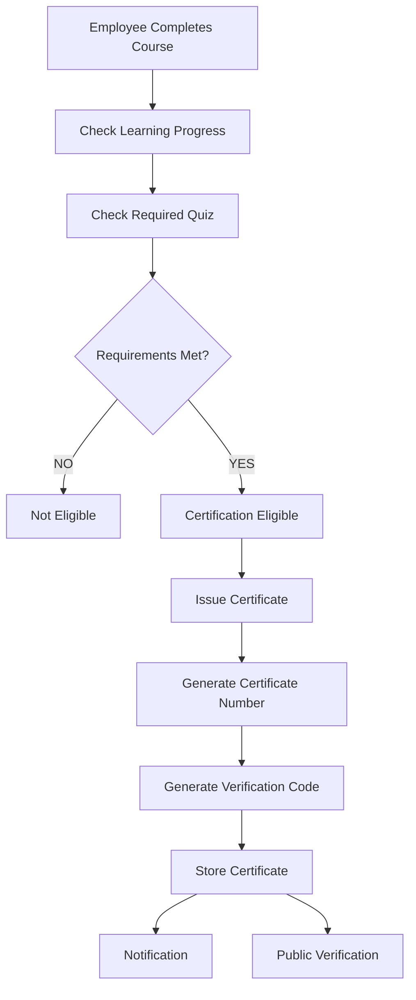

# Phase 6 — Certification & Competency Management
## 1. Architecture
Phase 6 extends the existing Express + Prisma + PostgreSQL LMS. It reuses the authenticated `User`, tenant `Company`, `Course`, `Enrollment`, `LessonProgress`, `Quiz`, and `QuizAttempt` models. The backend is authoritative for eligibility, certificate issuance, expiration, and competency calculation.

## 2. Database architecture
- `Certification`: company-scoped certification definition and lifecycle status.
- `CertificationRequirement`: course progress and optional quiz/score requirement.
- `Certificate`: immutable issued record with unique human-readable certificate number and opaque verification code.
- `Competency`: company-scoped competency definition.
- `CompetencyLevelConfig`: configurable score bands for Beginner, Intermediate, Advanced, and Expert.
- `CourseCompetency`: unique course-to-competency mapping with target level and weight.
- `EmployeeCompetency`: server-calculated per-user achievement, unique by user and competency.
- Notification enum values include certificate issued, expiring, expired, and revoked events.

The migration is `20260915040000_phase_6_certification_competency`. Prisma validation and client generation succeed.

## 3. Eligibility logic
`checkCertificationEligibility` verifies:

1. Certification is active.
2. Employee has a non-cancelled enrollment for the required course.
3. Completed lesson percentage meets the configured minimum.
4. A required quiz has a graded/passed attempt meeting the configured minimum score.
5. No active, unexpired certificate already exists for the employee and certification.

The frontend never calculates eligibility.

## 4. Certificate issuance flow
Course completion and quiz grading invoke the Phase 6 hooks without replacing Phase 4 progress or Phase 5 grading. Issuance runs in a Prisma transaction: eligibility check, secure identifier generation, certificate creation, activity log, and notification. Database unique constraints plus transactional logic protect certificate number and verification code uniqueness. Expired historical certificates are not overwritten; renewal creates a new record.

Certificate numbers use the `CERT-YYYY-######` format. Verification codes use cryptographically secure random bytes and do not encode internal IDs, user IDs, company IDs, email addresses, or timestamps.

## 5. Verification and privacy
`GET /api/certificates/verify/:verificationCode` is public. It returns only effective status, certificate number, verification code, certification title, recipient display name, company name, issue date, expiry date, and revocation date. It never returns email, employee ID, company ID, quiz answers, or internal database IDs.

The UI is available at `/verify/:verificationCode`. Active, expired, revoked, and unknown codes are displayed distinctly.

## 6. Expiration and renewal
Expiration is evaluated server-side by `getEffectiveStatus`: an active certificate with `expiresAt <= now` is exposed as `EXPIRED`. Revocation always takes precedence. This avoids dependence on a browser timer and preserves historical rows. The notification enum is prepared for expiring and expired events; scheduled delivery can be added when the existing application job strategy is introduced.

## 7. Competency calculation
When a course is completed, the backend reads the best existing graded quiz score (or 100 when no quiz is present), clamps it to 0–100, maps it to the competency's configured score bands, and applies the course target-level ceiling. Employee competency rows are upserted only when the new achievement improves the existing level or score. Completed contributing courses are filtered by the authenticated employee's own completed enrollments.

## 8. Authorization and tenant security
| Feature | HR | Instructor | Employee |
|---|---:|---:|---:|
| View certification | Yes | Own assigned-course certifications | Own/available information only |
| Create/edit/archive certification | Yes | No | No |
| View certificate | Company | Own assigned-course certificates | Own certificates |
| Revoke certificate | Company | No | No |
| View competency | Company | Company course context | Own competency |
| Create/edit/archive competency | Yes | No | No |
| Manage course competency | Yes | Assigned course only | No |

All company-scoped queries derive `companyId` from the authenticated session. Employee certificate and competency endpoints derive `userId` from the session and return 404 for another employee's records. Instructor certification and certificate reads are restricted to their assigned courses or required quiz courses.

## 9. API endpoints
- `GET/POST /api/certifications`
- `GET/PATCH /api/certifications/:id`
- `POST /api/certifications/:id/archive`
- `GET /api/certifications/:id/eligibility`
- `GET /api/certificates` and `GET /api/certificates/:id`
- `POST /api/certificates/:id/revoke`
- `GET /api/certificates/verify/:verificationCode`
- `GET /api/me/certificates`
- `GET /api/me/competencies` and `GET /api/me/competencies/:id`
- `GET/POST /api/competencies`
- `GET/PATCH /api/competencies/:id`
- `POST /api/competencies/:id/archive`
- `GET/POST /api/courses/:courseId/competencies`
- `DELETE /api/courses/:courseId/competencies/:competencyId`

HR list endpoints use server-side search, filters, sorting, and pagination.

## 10. Activity and notifications
Certification creation, update, archive, certificate issuance, revocation, and competency updates use the existing `ActivityLog`. Certificate issuance and revocation use the existing `Notification` model. Sensitive quiz answers and private employee information are excluded from audit metadata and public verification.

## 11. Testing and edge cases
The implementation covers active/expired/revoked/unknown verification, duplicate active certificate protection, historical renewal records, failed quiz, incomplete course, cross-company access, employee ownership checks, and backend-only score/eligibility decisions. Recommended integration tests should exercise concurrent issuance against the database unique constraints and verify that a revoked certificate remains queryable.

## 12. Verification performed
- Prisma schema validation: passed.
- Prisma client generation: passed.
- Frontend production build: passed (`vite build`).
- Node syntax checks for Phase 6 certification and certificate services: passed.
